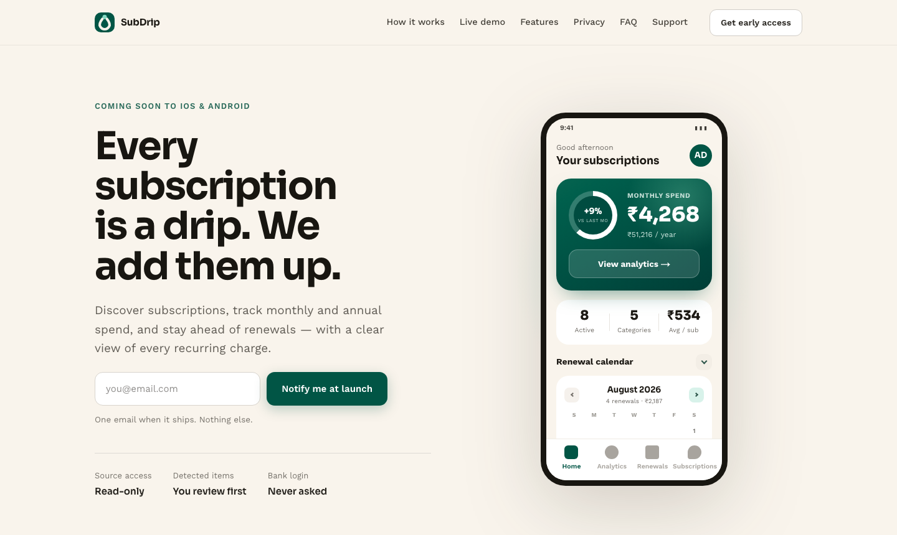
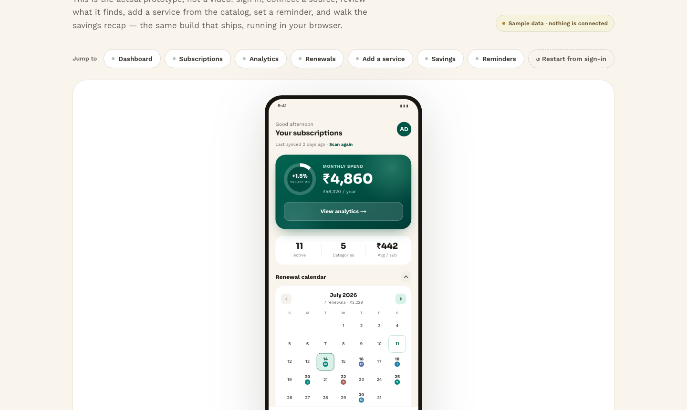
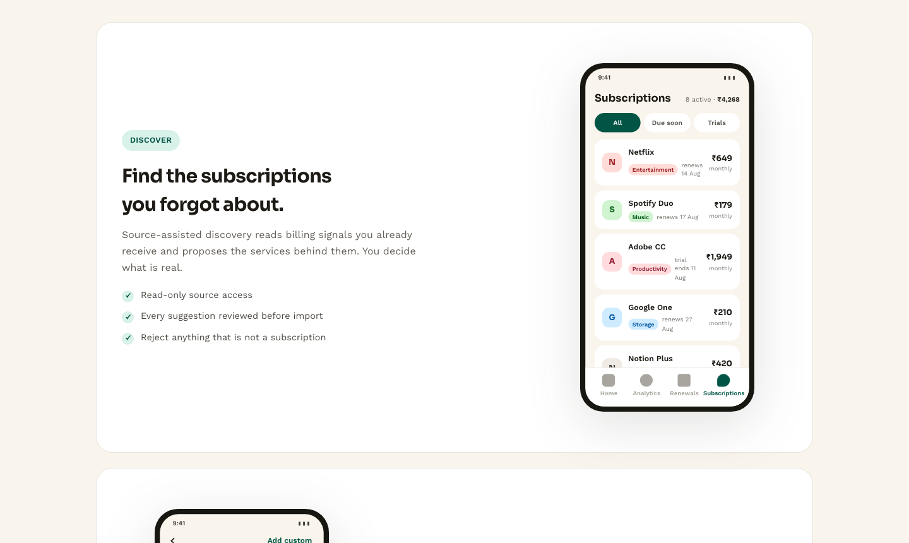

<div align="center">


# SubDrip

### Every subscription is a drip. We add them up.

The marketing website for **SubDrip** — the privacy-first app that finds your
recurring subscriptions and shows you what they really cost.


</div>

---

## 💧 What is SubDrip?

Streaming, music, cloud storage, AI tools — each one feels small until they add
up to one large number at the end of the year. SubDrip brings every recurring
charge into one place and keeps you ahead of it:

- 🔎 **Finds subscriptions you forgot about** — a read-only Gmail scan spots
  receipts and renewal notices and proposes the services behind them. Nothing
  is imported until *you* review and confirm it.
- ⚡ **Adds known services in three taps** — a regional plan catalog with
  suggested plans, prices, and an AI-estimated renewal date. Everything stays
  editable.
- 📊 **Shows where the money goes** — monthly total, annual projection,
  category breakdown, trends, and your highest-cost services ranked.
- ⏰ **Never lets a renewal surprise you** — a renewal timeline with reminders
  by push, email, or SMS, and an opt-in **full-screen alarm** that rings
  through silent for the charges you can't afford to miss.
- 💡 **Turns data into savings** — ranked ideas with the evidence behind each
  one: duplicate plans, price rises, trials about to convert, barely-used
  services.
- 🔐 **Privacy-first, always** — read-only source access, no bank logins ever,
  and delete-everything built in.

## 🖥 The website

This site tells that story across nine pages — including a **live demo** where
you can click through the actual app screens in your browser, with sample data
and nothing connected.

| | |
|---|---|
| **Home** | The problem, how it works, and the payoff — with a ₹ INR / $ USD price toggle |
| **Live demo** | The real app screens, explorable: dashboard, renewals, analytics, catalog, savings |
| **Features** | Each feature next to the phone screen it lives on |
| **Privacy & Data deletion** | Plain-language data practices and both deletion routes |
| **FAQ & Support** | Answers by category, plus a contact form |
| **Get early access** | Join the waitlist — one email when it ships, nothing else |

<div align="center">







</div>

## ⚡ Run it locally

```bash
npm install
cp .env.example .env.local   # DATABASE_URL enables the waitlist (optional for browsing)
npm run dev                  # http://localhost:3000
```

<details>
<summary><b>Deploying & configuration</b></summary>

- **Vercel:** add the `DATABASE_URL` environment variable (marked *Sensitive*).
  Waitlist signups are stored in the project's Postgres — no extra backend
  needed. If this folder lives inside the monorepo, also set the project's
  Root Directory to `website/`.
- Every page is statically prerendered; only the waitlist API route runs on
  demand, so deploy on a Node host (Vercel / `next start`).
- Brand name, tagline, and colors live in [`src/lib/brand.ts`](src/lib/brand.ts).

</details>

---

<div align="center">
<sub><b>SubDrip</b> © 2026 · One email when it ships. Nothing else.</sub>
</div>
